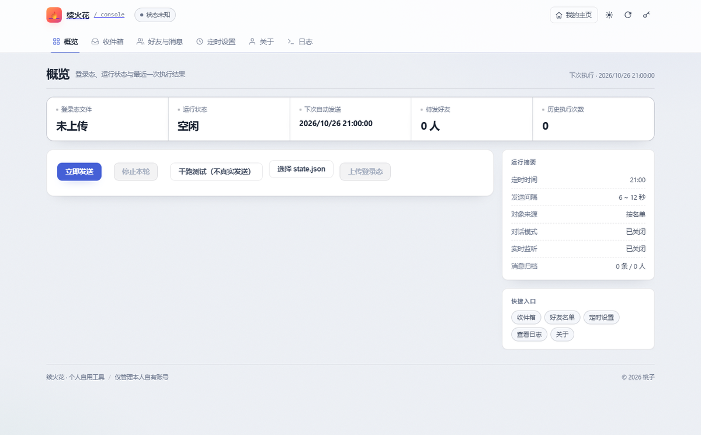
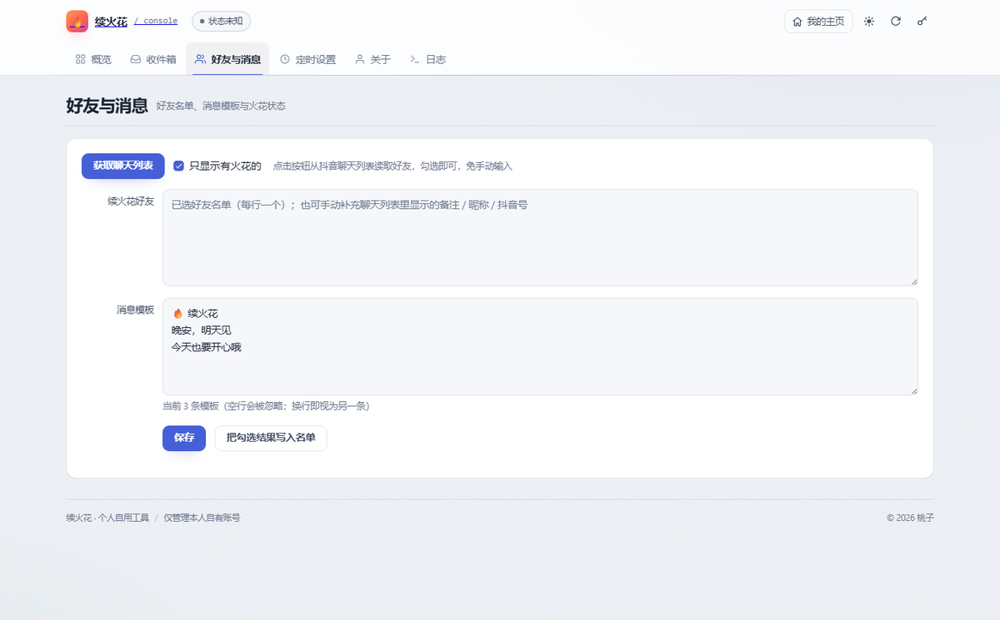

# spark-console

> 一个多账号「续火花」自动化的**工程实现参考** —— 用 Playwright 驱动抖音网页版，在服务器上无人值守地维护好友火花，并提供一个可视化控制台。

<p align="center">
  
  
  
  
</p>

---

## ⚠️ 免责声明（请先读这段）

- 本项目**仅供个人学习浏览器自动化、异步渲染处理、多实例调度等工程问题**。
- 使用自动化脚本操作抖音，**很可能违反其用户协议**，存在限流、封号风险。由此产生的一切后果由使用者自行承担。
- **禁止**将本项目用于：批量营销、骚扰他人、养号卖号、任何形式的牟利行为。
- 请仅对**自己的账号**使用，且遵守平台规则与当地法律法规。
- 仓库中不含任何账号凭据、登录态或真实服务器信息，使用者需自行配置。

如果你只是想「每天给朋友续个火花」，手动点一下比部署这套东西省事得多。这个项目真正的价值在**技术实现**，不在功能本身。

---

## 界面预览

| 概览 | 好友与消息 |
|---|---|
|  |  |

---

## 这个项目解决什么问题

抖音的「火花」需要**每天**和好友互发消息才能维持。手动维护十几个人很烦，所以有了这个项目。但做完之后，真正值得记录的是过程中踩到的坑：

| 工程问题 | 本项目中的解法 |
|---|---|
| 登录态在服务器上（无 GUI）怎么维持？ | 本机扫码 → 导出 `storage_state` → 加密上传 → 服务器复用 |
| 网页元素**异步渲染**，抓早了就是空值 | 两阶段抓取 + 屏内等待 + 多轮补齐（见 `docs/ARCHITECTURE.md`） |
| 列表**虚拟滚动**，滚过的行会被卸载 | 按「单行容器」边界定位 + 按名合并而非整条判重 |
| 元素在 DOM 里但**不可见**，点击直接报错 | `scroll_into_view` → 常规点击 → JS 点击三级兜底 |
| 机房 IP 被风控弹滑块 | 真实 UA / 时区 / `navigator.webdriver` 伪装 + 失败重试 |
| 多账号互不干扰 | systemd 模板实例 + 独立端口 + 独立数据目录 |
| 服务重启后任务状态错乱 | 运行时状态与配置分离，启动时清理残留标志 |

---

## 功能

- **多账号**：一套控制台管理多个抖音账号，各自独立进程、端口、数据目录
- **自动续火花**：定时（可设抖动）按名单发送，随机文案，随机间隔
- **每日文案（可选）**：开启后按「日期 + 好友」离线生成文案，每人一条、天天不同；面板可按日期预览，**预览到的就是真发出去的**。与手写「消息模板」二选一，不叠加
- **火花过滤**：只给「确实有火花」的好友发，避免打扰无关会话
- **可视化面板**：好友勾选、文案编辑、定时设置、日志查看、干跑测试
- **火花热力图**：概览页一屏画出过去一年的每日续火花强度（深红 = 全员续上，留白 = 断签），
  下方是每位好友近 90 天的连续天数条带，断得最多的排最前；今天该发而没发会在卡片顶部亮红条。
  数据按天聚合存在 `data/send_history.json`，干跑不计入
- **扫码工具**：纯浏览器版二维码/条码识别（手机拍照即可，无需装 App）
- **实时监听**（可选）：轮询未读会话，配合自动回复草稿
- **登录态健康度**：预测剩余有效天数，临近过期提前告警

---

## 架构

```
┌──────────────────────────────────────────────────────────┐
│  浏览器                                                    │
│  ├─ /            个人主页（可替换成任意静态页）              │
│  ├─ /console     账号列表：口令登录 → 选账号 → 内嵌面板      │
│  └─ /scan        扫码工具（HTTPS 下可直接调摄像头）          │
└───────────────┬──────────────────────────────────────────┘
                │ 反向代理 /p/{acc}/*  （自动注入面板令牌）
┌───────────────▼──────────────────────────────────────────┐
│  spark-console  :80   FastAPI                             │
│  ├─ 账号健康检查、令牌注入、审计日志                        │
│  └─ /api/agent/*  本机扫码助手的长轮询通道                  │
└───────┬──────────────────────────────┬───────────────────┘
        │ 反代到各实例                  │
┌───────▼─────────┐            ┌───────▼─────────┐
│ douyin-spark@a  │            │ douyin-spark@b  │
│ :8000           │            │ :8001           │
│ panel + 自动化   │            │ panel + 自动化   │
│ data/a/         │            │ data/b/         │
└───────┬─────────┘            └───────┬─────────┘
        │                              │
        └──────────┬───────────────────┘
                   ▼
        Playwright + Chromium（无头）
                   │
              www.douyin.com
```

**关键设计**：控制台不直接操作抖音，只做「账号路由 + 令牌注入 + 健康检查」；真正的自动化跑在各实例自己的进程里。这样单实例崩溃不影响其他账号。

> 首页是可选的：把任意静态页存成 `console/home.html`，`/` 就会展示它、控制台留在 `/console`；
> 不放这个文件（默认 clone 下来就是这种情况），`/` 直接就是控制台。主页通常含个人信息，已列进 `.gitignore`，只放服务器。

---

## 快速开始

### 前置

- Python 3.11+
- 一台能**长期开机**的机器：Linux 服务器最省心；**Windows / macOS 也完全能跑**，见下方「关于 Windows」
- 你有权操作的抖音账号

### 1. 装依赖

```bash
git clone https://github.com/<你的用户名>/spark-console.git
cd spark-console/douyin-spark

python -m venv .venv
.venv/bin/pip install -r requirements.txt

# 国内务必用镜像，官方源下 Chromium 会卡在 10%
export PLAYWRIGHT_DOWNLOAD_HOST=https://cdn.npmmirror.com/binaries/playwright
.venv/bin/playwright install chromium
```

### 2. 配置

```bash
cp .env.example .env          # 必须放在 douyin-spark/ 目录下，程序只读同目录的 .env
```

编辑 `.env`，至少改两项：

```bash
# 1) 先在终端生成一个令牌，把输出的 32 位十六进制填进 .env 的 AUTH_TOKEN
openssl rand -hex 16
```

```ini
# 2) .env 里要写实际值，不能写 $(...) 这种命令——程序不解析 shell
AUTH_TOKEN=上一步生成的32位字符串
SPARK_DATA_DIR=./data          # 数据目录；多账号时每个账号指向不同目录
```

> - 公网部署 `AUTH_TOKEN` 必须设置，留空等于面板裸奔；仅本机自用可以留空。
> - 变量名是 `SPARK_DATA_DIR`，不是 `DATA_DIR` —— 写错会静默回退到默认目录，多账号时数据互相覆盖。

### 3. 拿到登录态

这一步**必须在一台有桌面的电脑上做**（服务器通常没有图形界面，扫码出不来）。

```bash
# 在你自己的电脑上（Windows/macOS 都行）
pip install playwright && playwright install chromium
python extract_cookie.py     # 弹出浏览器 → 扫码登录 → 自动写出 state.json
```

把生成的 `state.json` 传到服务器，然后在面板「概览 → 上传登录态」提交。

> 为什么不在服务器上扫码：机房 IP 容易触发滑块验证，甚至点击「登录」后页面完全不弹登录框。本机扫码 + 复用登录态是最稳的路径。

### 3.1 控制台一键扫码（本机助手）

控制台里点「扫码登录」→「用本机扫码（会弹窗）」，会调用**你自己电脑**上的助手弹出真实浏览器，
扫码成功后登录态自动回传服务器、写入该账号的 `state.json`，无需手动上传。

前提是本机助手在跑：

```bash
cd douyin-spark
# server.txt     → 一行服务器地址，例如 http://154.8.168.48
# local-key.txt  → 一行【管理员口令】（控制台登录用的那个，访客口令无效）
启动扫码助手.bat      # Windows 双击
```

窗口里出现 `✅ 已连上服务器且口令正确` 才算就绪；之后窗口一直开着（可最小化），关掉就等于停用扫码。

点按钮后会**在你电脑上弹出真实的 Chrome 窗口**，抖音的扫码登录框通常直接展开：

- 助手用的是**本机 Chrome + 每个账号独立的配置目录**（`douyin-spark/.agent-profile/<账号>`），
  不是 Playwright 自带的内置 Chromium —— 后者会被抖音识别成自动化环境，直接弹「请完成下列验证」的滑块，
  页面上根本没有二维码，看起来就像"弹窗没用"。没装 Chrome 时才回退内置 Chromium。
- 窗口可能被挡在其他窗口后面：没看到就按 `Alt+Tab` 或看任务栏。
- 万一仍被要求滑块验证，控制台会提示「抖音要求滑块验证」，在窗口里拖一下滑块，二维码会自动出来。
- 配置目录按账号分开，避免扫 B 号时浏览器还带着 A 号的登录态。

**中途放弃/关掉窗口了想重来**：点弹窗里的「取消」，再点「用本机扫码」即可出新码。
助手下一次心跳会收到 `abort` 并把旧窗口关掉；如果连助手窗口一起关了，重新双击启动，
它会用自己的启动标识告诉服务器"上一单作废"，不会卡在"有一单正在进行"。
（20 秒内连点仍然算同一单，防止误触把二维码刷新掉。）

排障自检（把「口令不对」和「连不上」分开报）：

```bash
.venv\Scripts\python.exe spark-agent.py --check http://154.8.168.48 管理员口令
```

注意控制台里「本机助手」那行状态有三种：`在线` / `口令不对`（连上了但 401）/ `未运行`，
看到「口令不对」时改 `local-key.txt` 即可，不必重装任何东西。

### 4. 启动

```bash
.venv/bin/python app.py     # 默认 :8000（可用 .env 里的 PORT 改）
```

打开 `http://<你的IP>:8000`，输入 `.env` 里的 `AUTH_TOKEN` 即可进入面板。

### 5. 先验证再订阅

上传登录态后，按这个顺序确认链路通：

1. 「好友与消息」→ 点「获取聊天列表」→ 能看到好友和火花天数（约 1~3 分钟）
2. 勾选 1 个人 → 保存 → 回「概览」→ 点「**干跑测试**」
3. 日志出现 `已发送给 xxx：（干跑，未真实发送）` 才算通

确认没问题再设定时，否则容易在正式跑的时候才发现问题。

### 6. 多账号（可选）

见 `docs/DEPLOY.md` 里的 systemd 模板实例方案。

---

## 目录结构

```
.
├── console/                 统一控制台（多账号）
│   ├── app.py               FastAPI：账号管理、反代、扫码 API
│   ├── index.html           账号列表 + 内嵌面板
│   ├── scan.html            浏览器扫码工具
│   ├── nginx-spark.conf.tpl HTTPS 站点模板
│   └── enable-https.sh      一键切到 nginx + HTTPS
│
├── douyin-spark/            单账号面板与自动化（核心）
│   ├── app.py               面板后端
│   ├── core/
│   │   ├── automation.py    ★ 抓列表、切会话、发消息（最有参考价值）
│   │   ├── chat.py          会话内读消息、发文本
│   │   ├── watcher.py       实时监听轮询
│   │   ├── autoreply.py     自动回复（草稿/全自动）
│   │   ├── reply_engine.py  回复内容生成
│   │   ├── scheduler.py     定时任务与抖动
│   │   ├── config.py        配置读写与校验
│   │   ├── runtime.py       运行时状态（与配置分离）
│   │   ├── browser_pool.py  浏览器实例复用
│   │   ├── msgstore.py      消息归档与去重
│   │   ├── inbox.py         收件箱扫描
│   │   └── notify.py        告警通知
│   ├── static/index.html    面板前端（Vue 3 + Element Plus，本地打包无 CDN）
│   ├── extract_cookie.py    本机扫码导出登录态
│   └── spark-agent.py       本机扫码助手（长轮询服务器任务）
│
├── docs/
│   ├── ARCHITECTURE.md      ★ 核心实现思路与踩坑记录
│   ├── DEPLOY.md            部署、多账号、HTTPS、排障
│   └── research/            立项时的调研报告（其他方案对比、服务器选型）
│
├── bootstrap-douyin-spark.sh   一键初始化服务器
├── spark-add-account.sh        新增账号（写 env + 数据目录）
├── spark-status.sh             所有账号状态总览
├── gh-wait-restart.sh          等待任务结束后重启（示例脚本）
└── ssh_exec.py                 远程执行小工具（读环境变量）
```

---

## 核心思路（想看代码的直接读这两份）

- **[docs/ARCHITECTURE.md](docs/ARCHITECTURE.md)** —— 异步渲染、虚拟列表、稳定定位、反检测、状态机设计的完整拆解
- **[docs/DEPLOY.md](docs/DEPLOY.md)** —— 从裸机到 HTTPS 的部署细节

如果只读一个文件，读 `douyin-spark/core/automation.py`，里面每个"奇怪"的写法旁边都有注释说明为什么。

---

## 可以怎么魔改

这个项目的模块边界比较清晰，以下方向都能独立改：

| 想做的事 | 从哪下手 |
|---|---|
| **换平台**（B 站、快手、小红书…） | `core/automation.py` 的选择器与流程；保持 `run_send()` 签名不变即可接现有调度 |
| **换通知渠道** | `core/notify.py`，目前是 webhook，支持钉钉/飞书/Server酱 |
| **接自己的大模型** | `reply_engine.py`，改 `llm_base_url` / `model` 即可（兼容 OpenAI 协议） |
| **改成固定文案或模板变量** | `config.py` 的 `messages`，发送时 `random.choice`，可替换成模板引擎 |
| **加 Web UI 功能** | `static/index.html` 是单文件 Vue，`:root` 里改主题变量即可换肤 |
| **去掉多账号，只留单实例** | 删掉 `console/`，直接跑 `douyin-spark/app.py`，功能完整 |
| **换成纯 API 方案** | 本项目用浏览器自动化是因为没有官方接口；若有合法 API，替换 `automation.py` 内部实现即可，上层不用动 |
| **做通用的网页自动化框架** | `automation.py` 里「异步渲染 + 虚拟列表 + 稳定定位」三件套可以抽象出来复用 |

**不建议改的地方**（会牵一发动全身）：
`config.py` 的字段名（前端硬编码引用）、`runtime.py` 的状态结构（涉及并发）、`scheduler.py` 的触发语义。

---

## 来源与致谢

**核心自动化引擎基于开源项目 [DouYinSparkFlow](https://github.com/2061360308/DouYinSparkFlow)（MIT License，见 `douyin-spark/LICENSE`）。**

本仓库在其基础上做的二次开发：

| 部分 | 说明 |
|---|---|
| `console/` | 全新：多账号控制台、令牌注入代理、健康度检查、浏览器扫码工具 |
| `douyin-spark/spark-agent.py` | 全新：本机扫码助手，通过长轮询让"网页点一下就能在本机弹窗扫码" |
| `core/watcher.py` `core/autoreply.py` `core/reply_engine.py` `core/inbox.py` `core/msgstore.py` | 实时监听、自动回复、消息归档 |
| `core/automation.py` | 大量稳定性修复：火花异步渲染补齐、虚拟列表定位、点击兜底、火花缓存回退 |
| `core/history.py` | 全新：按天聚合的发送账本，为热力图提供一年序列、连续天数与断签预警 |
| `core/scheduler.py` | 修复抖动配置 `0` 被静默改成 `30` 的问题 |
| `docs/` | 架构解析与部署文档 |

如果上游有更新，建议优先合并上游的选择器修复——那部分变动最频繁。

> `douyin-spark/README.md` 与 `douyin-spark/LICENSE` 均为上游原始文件，保留以示出处；
> 本仓库的总体说明以根目录 `README.md` 为准。

> 若你是上游作者且不希望被引用，请提 Issue，我会移除。

---

## 已知限制

- 抖音网页版 DOM 会变，选择器需要不时维护（这是这类项目的宿命）
- 机房 IP 容易被风控，服务器上扫码成功率低于本机
- 单实例同时只能跑一个发送任务（有互斥锁）
- 抓取聊天列表需要 1~3 分钟（多轮补齐火花状态，慢是刻意的）
- 没有数据库，全部用 JSON 文件，适合单机不适合集群
- Windows 没有现成的服务化方案，重启后需手动启动（可用 NSSM 或任务计划程序解决，见下）

---

## 关于 Windows

**Windows 完全可以运行本项目**——开发与调试就是在一台 Windows 上完成的，所有功能一致。

区别只在「无人值守」这一层：

| 需求 | Linux | Windows |
|---|---|---|
| 启动 | `.venv/bin/python app.py` | `.venv\Scripts\python.exe app.py` |
| 开机自启 | systemd（见 docs/DEPLOY.md） | 任务计划程序 或 [NSSM](https://nssm.cc/) 注册为服务 |
| 崩溃自动重启 | `Restart=always` | NSSM 内置 |
| 常开 | 服务器天生如此 | 需要关闭休眠/自动关机，并接受电费 |

**Windows 开机自启（任务计划程序）**：

1. Win+R 输入 `taskschd.msc`
2. 创建基本任务 → 触发器选「计算机启动时」
3. 操作填 `D:\path\to\douyin-spark\.venv\Scripts\python.exe`，参数填 `app.py`，起始于填项目目录
4. 勾选「使用最高权限运行」

或者用 NSSM（更省心）：

```powershell
nssm install SparkPanel "C:\path\to\douyin-spark\.venv\Scripts\python.exe" "app.py"
nssm set SparkPanel AppDirectory "C:\path\to\douyin-spark"
nssm start SparkPanel
```

**macOS**：`launchd` 或直接开一个终端窗口挂着。

---

## 贡献

欢迎提 Issue 和 PR，尤其是「选择器失效」的修复 —— 这是最容易过期的部分。详见 [CONTRIBUTING.md](CONTRIBUTING.md)。

**提交 PR 前请确认**：不要包含任何真实账号、登录态、服务器地址或凭据。

---

## License

[MIT](LICENSE) —— 随便用、随便改，保留版权声明即可。

使用边界与风险见 [DISCLAIMER.md](DISCLAIMER.md)。
